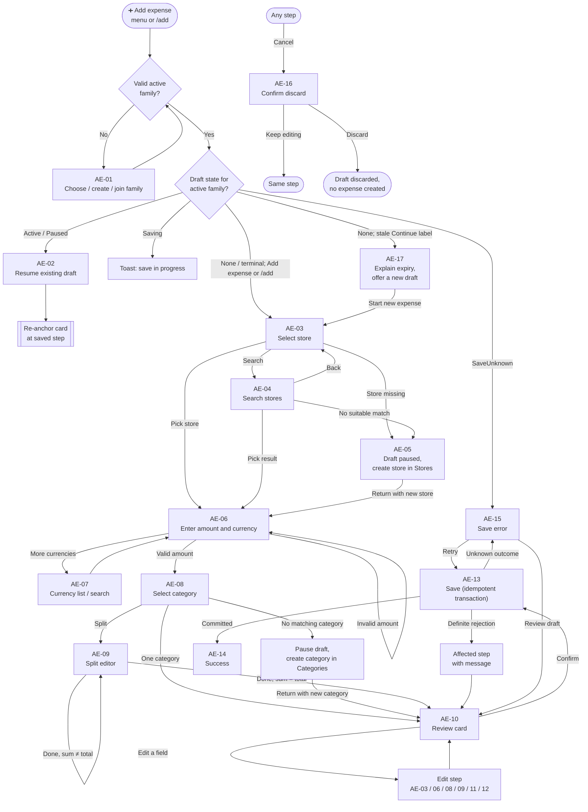
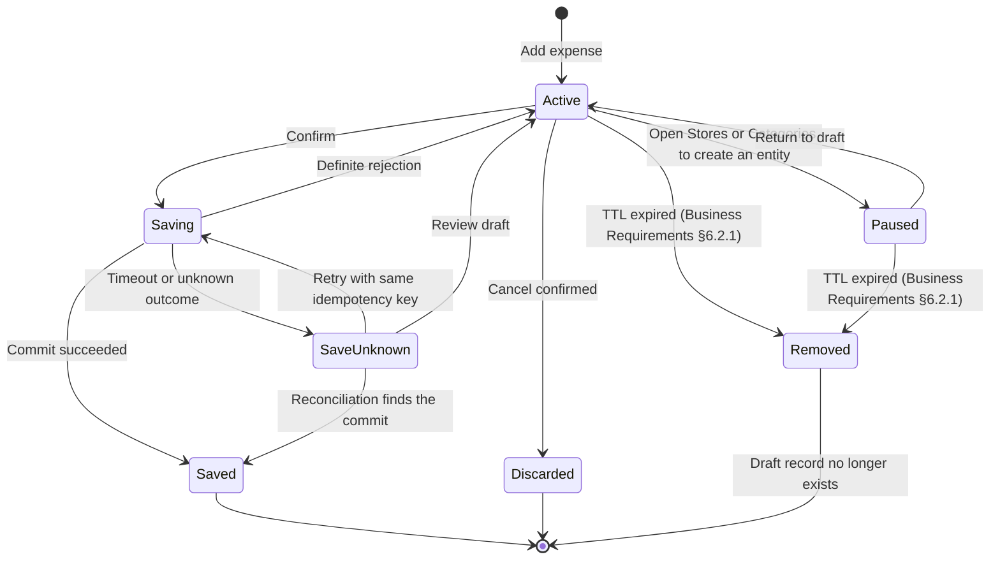
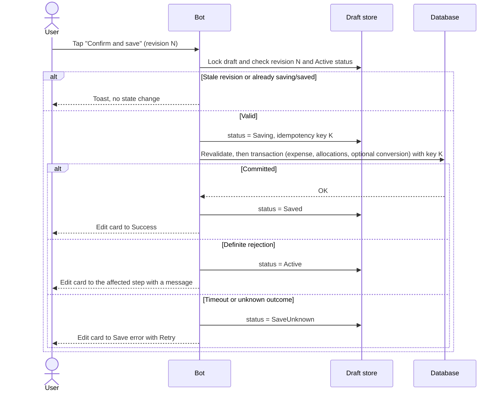

# Family Expenses MVP — UI/UX Specification

## Scenario 1: Add an expense

**Interface:** Standard Telegram bot chat with **one editable expense card** and inline keyboards\
**UI source language:** English. Localized text is selected per user (Business Requirements §12).\
**Scope:** Add a shared family expense from the main menu through successful persistence\
**Out of scope:** Personal expenses, Mini App, Stores/Categories management screens, StoreAlias management, editing/deleting a saved expense, report generation, expense notes\
**Business requirements:** [business_requirements.md](../business_requirements.md) §§5, 6.2–6.7, 7.1–7.3, 12\
**NFRs:** [nfr_requirements.md](../nfr_requirements.md) §§1–3

---

## 1. Overview

Expense behavior and domain rules are in [Business Requirements §§5–7](../business_requirements.md); security, data, and reliability constraints are in [NFR §§1–3](../nfr_requirements.md). This specification defines how expense creation is presented and handled in Telegram.

## 2. Interaction model

### 2.1 Principles

1. **One card per draft.** The card is the single visible source of truth for the draft. Every step edits the card instead of sending a new message.
2. **Text input.** When a value must be typed (amount, search query, category amount, date, rate), the card's prompt asks for it and the draft enters an *awaiting input* state. The user's message stays in the chat; the bot does **not** delete it. After processing, the bot edits the card. Errors appear on the card's error line, not as new messages.
3. **No ForceReply.** It would require a second prompt message and break the one-card model.
4. **Buttons do not send messages.** Tapping an inline button edits the card and always answers the callback query (to stop the loading indicator).
5. **Card re-anchoring.** If the card is no longer usable where it is (the draft was resumed after a detour, the edit failed, or the user asked to show it again), the bot sends a **new card** at the bottom and edits the old one to a closed state with no buttons: `↓ This draft continues in a newer message.` (`card.moved`).
6. **Formatting.** Use Telegram HTML parse mode and escape every user-provided string (store, category names).
7. **Active family is always visible** in the card header.
8. Draft ownership and family isolation follow Business Requirements §6.2.1.
9. **Toasts vs. card lines.** Callback problems (stale button, "still saving") use a short toast. Problems with typed input use the card's error line.

### 2.2 Card anatomy

```
🧾 New expense · 👪 {family_name}

🏪 Store: {store_name | not selected yet}
💰 Amount: {amount} {currency} | not entered yet
🏷 Category: {category_line(s) | not selected yet}
📅 Date: {date} (today)

{conversion block — review only}

{error line: ⚠️ …}            ← only when there is an error
{prompt for the current step}
[inline keyboard]
```

- Fields are always shown, with a placeholder when empty, so the card layout stays stable.
- Category rows with several allocations are listed one per line: `• {category} — {amount} {currency}`.
- The date shows `(today)` / `(yesterday)` when applicable.
- Money is shown as `amount currency-code` (ISO code, never a symbol), with the decimal separator of the user's locale and no thousands grouping.

### 2.3 Example (store and amount entered, category pending)

```
🧾 New expense · 👪 Kowalski family

🏪 Store: Biedronka
💰 Amount: 125.50 PLN
🏷 Category: not selected yet
📅 Date: 26 Oct 2026 (today)

🏷 Choose a category for 125.50 PLN.

[ ⭐ Groceries ] [ Household ]
[ Health ] [ Other ]
[ 🧩 Split between categories ]
[ ⬅️ Back ] [ ✖️ Cancel ]
```

### 2.4 Handling of incoming messages

| Situation | Reaction |
|-----------|----------|
| Text while the draft awaits text input | Parse according to the current step (§6). |
| Text while no input is awaited | Edit nothing; reply once with `input.unexpected` and a `Show card` button (`btn.show_card`). |
| Non-text message (photo, sticker, voice…) while text is awaited | Card error line `input.not_text`. |
| Telegram redelivers the same update | Ignored by `update_id`; no state change, no duplicate message. |
| Tap on a stale button (old revision, old card, closed draft) | Toast `callback.stale`; if the draft is still active, re-anchor the current card. |
| Tap while the draft is `saving` | Toast `save.in_progress`. |
| Tap on a button of an expired draft | Edit that card to the expired state (AE-17). |

---

## 3. UI inventory

All localization keys are prefixed `expense.add.` in this document; the prefix is omitted in tables.

| ID | State | Entered from | Exits to |
|----|-------|--------------|----------|
| AE-00 | Entry (menu / `/add`) | Dynamic reply-keyboard expense action or `/add` | AE-01, AE-02, AE-03, AE-15, AE-17 |
| AE-01 | Family context | AE-00 | AE-03 |
| AE-02 | Resume existing draft | AE-00 when an active/paused draft exists for active family | Re-anchor at the saved step |
| AE-03 | Select store | AE-00/01, edit from review | AE-04, AE-05, AE-06, AE-10 |
| AE-04 | Search stores | AE-03 | AE-03, AE-05, AE-06, AE-10 |
| AE-05 | Draft paused: create store/category in its section | AE-03/04, AE-08/09a | AE-06 (store return), AE-10 (category return), AE-09b (split category return), AE-02 |
| AE-06 | Enter amount (+ currency chips) | AE-03/04/05, edit from review | AE-07, AE-08, AE-09, AE-10 |
| AE-07 | More currencies (list + search) | AE-06 | AE-06 |
| AE-08 | Select category | AE-06, edit from review | AE-09, AE-10 |
| AE-09 | Split between categories (sub-states 09a, 09b) | AE-08, amount change with split | AE-10 |
| AE-10 | Review (conversion sub-states) | AE-08/09 | AE-03/06/08/11/12, AE-13, AE-16 |
| AE-11 | Edit date | AE-10 | AE-10 |
| AE-12 | Manual exchange rate | AE-10 | AE-10 |
| AE-13 | Saving | AE-10, AE-15 | AE-14, AE-15, affected step |
| AE-14 | Success | AE-13 | New draft (AE-03) |
| AE-15 | Save error / unknown outcome | AE-13 | AE-13, AE-10, AE-14 |
| AE-16 | Cancel confirmation / draft discarded | Any step | Same step, end |
| AE-17 | Expired draft (UI response) | Stale Continue menu label after TTL removal | AE-03 (new draft) |
| AE-18 | Stale callback / unexpected input | Any | Same state |

### Shared controls

| Control | Key | Behavior |
|---------|-----|----------|
| `✖️ Cancel` | `btn.cancel` | AE-16. Shown on every card state except AE-13, AE-14, AE-16, AE-17. |
| `⬅️ Back` | `btn.back` | Returns to the previous logical step (table below); preserves valid values. |
| `⬅️ Back to review` | `btn.back_to_review` | Replaces `Back` when the step was opened from the review card. |
| `Show card` | `btn.show_card` | Re-anchors the card at the bottom of the chat. |

**Back targets (forward flow):** AE-04 → AE-03 · AE-06 → AE-03 · AE-07 → AE-06 · AE-08 → AE-06 · AE-09 → AE-08 · AE-10 has no Back (use field edits) · AE-11, AE-12 → AE-10.

---

## 4. User flows

### 4.1 Main flow (card states)



### 4.2 Draft lifecycle



### 4.3 Save sequence



### 4.4 Errors, cancellation, and retries

| Situation | Outcome |
|-----------|---------|
| Invalid typed value | Error line on the card; the same prompt stays active; only the affected value is re-requested. |
| `Back` | Previous step; valid values preserved. |
| `Cancel` before a store is chosen | Draft discarded immediately (nothing meaningful entered). |
| `Cancel` after a store is chosen | AE-16 confirmation. `Keep editing` returns to the same step. |
| Save outcome unknown, user taps `Cancel` | First reconcile by idempotency key. If committed → show success (`save.committed_meanwhile`); otherwise normal cancel confirmation. |
| Save rejected because a referenced store/category is no longer available | Return to the matching selection step with `store.unavailable` / `category.unavailable`. |
| Membership lost | Draft closed, nothing saved, message `membership.lost`. |
| Reporting currency changed by another member while the draft is open | Conversion is recalculated; review is shown again with `conversion.reporting_changed`. Saving is not silent. |
| Draft expired | AE-17; no partial expense exists. |
| Bot restart | Draft is restored from durable storage (§8); the next tap or the "Add expense" action re-anchors the card. |

---

## 5. UI specification per state

### AE-00 — Entry

- The reply-keyboard labels, family-first draft lookup, and lifecycle behavior follow Business Requirements §5 and §6.2.1. Both menu labels and `/add` enter this state; map resumable drafts to AE-02, unresolved saves to AE-15, and a stale Continue label after TTL removal to AE-17.
- Creating a draft does not create an expense.

### AE-01 — Family context

- No family: route to onboarding (separate scenario).
- Several families and none active: show a family selector (`family.select.prompt`: "Which family is this expense for?") with one button per family, then continue.
- Several families and one active: use it; the header always shows its name.
- `👪 Change family` (`btn.change_family`) appears on AE-03 only while no store has been chosen and the user has more than one family. It changes the active family context; it never changes the draft's `family_id`. The current draft remains saved under `(user_id, previous_family_id)`. The general family selector remains available during the flow; switching family leaves the old draft inaccessible in the new context. Switching back restores access, subject to the draft's 24-hour lifetime. The new family resumes its own draft if one exists, or starts a new draft.

### AE-02 — Resume existing draft

Entered by AE-00 when an Active or Paused draft exists for `(user_id, active_family_id)`. Resume it directly and re-anchor the existing card at the saved step; a paused draft returns to the step it was paused at. Do not send a continue/discard prompt. The user can discard the draft through the normal Cancel flow, then use the reply-keyboard expense action to start a new one.

### AE-03 — Select store

| Key | English |
|-----|---------|
| `store.prompt` | 🏪 Choose the store for this expense, or search by name. |
| `store.empty` | Your family has no stores yet. Add the first store in the Stores section. |
| `store.unavailable` | “{store_name}” is no longer available. Choose another store. |

**Controls**

| Button | Key | Action |
|--------|-----|--------|
| Store buttons (2 per row, 8 per page) | — | Select the store. |
| `‹ Previous` / `Page {n}/{m}` / `Next ›` | `btn.page_prev`, `btn.page_next` | Pagination. |
| `🔎 Search` | `btn.search` | AE-04. |
| `➕ Add new store` | `btn.store_add` | AE-05. |
| `👪 Change family` | `btn.change_family` | Only as described in AE-01. |
| `✖️ Cancel` | `btn.cancel` | AE-16. |

**Rules**

- Only stores of the active family are listed. Archiving is out of scope for MVP, so every store of the family is listed.
- Order: recently used stores first, then alphabetical. Show 8 stores per page; long names are truncated on the button only.
- Selecting a store sets it in the draft. If the user has not customized the category allocation (`category_customized = false`), the store's default category is preselected in the draft and shown in AE-08. Then go to AE-06, or back to AE-10 when opened from review.
- If the family has no stores, show `store.empty` with `➕ Add first store` and `✖️ Cancel`. `Add first store` opens the Stores section's create form with no prefilled name.
- If the tapped store no longer exists, show a toast with `store.unavailable` and refresh the list.

### AE-04 — Search stores

| Key | English |
|-----|---------|
| `store.search.prompt` | 🔎 Send the store name to search. |
| `store.search.results` | Stores matching “{query}”: |
| `store.search.none` | No stores found for “{query}”. Create it in the Stores section or try another name. |
| `store.search.empty` | Send at least one letter or digit. |
| `store.search.limited` | Search is limited right now. Only close name matches are shown. |
| `store.search.unavailable` | Search is temporarily unavailable. Choose a store from the list. |

**Controls:** up to 5 result buttons · `➕ Create store “{query}”` (`btn.store_create_query`) when no result is suitable, including when fuzzy suggestions are shown · `⬅️ Back` · `✖️ Cancel`. The create button opens the Stores section and is prefilled with the exact search query; the Stores section checks hard duplicates and handles similar-name warnings. It does not create the store in the expense flow.

**Rules**

- The search is family-scoped and supports case, diacritic, transliteration, and fuzzy matching (Business Requirements §6.3).
- Fuzzy and transliterated matches appear as ordinary candidates. **Never select a store automatically because of similarity.**
- The query is trimmed; length 1–100 characters; it must contain at least one letter or digit.
- After results or "no results", the draft stays in search mode: a new text message performs a new search.
- If the search index is unavailable, use the database fallback and show `store.search.limited`; if nothing works, show `store.search.unavailable` and return to the list.
- Picking a result behaves like picking a store in AE-03.

### AE-05 — Draft paused: create the store in the Stores section

Business Requirements §6.2: stores are created only in the Stores section, and the in-progress draft is preserved.

| Key | English |
|-----|---------|
| `draft.paused_for_creation` | ⏸ Your expense draft is saved until {expires_at}. Create {entity_name} in the {section_name} section, then come back with the button below or with “Add expense”. |

**Controls:** `↩️ Back to expense` (`btn.entity_return`) · `✖️ Cancel`.

**Steps**

1. The draft status becomes Paused (reason `store_creation`); expiry follows Business Requirements §6.2.1.
2. The bot opens the Stores section's create form as a new message, carrying the return context (Appendix A). When started from a no-results search, prefill the name with the exact trimmed search query and show it as editable.
3. After the store is created, the Stores flow offers `↩️ Back to expense`. The bot re-anchors the card, **selects the new store**, and continues at AE-06.
4. Alternatively, the user taps `Continue creating expense` (or `/add`) → AE-00 → AE-02 to reopen the paused draft. The new store is then available in the list but is **not** selected automatically unless the Stores flow's `Back to expense` action is used.
5. If the draft expired meanwhile → AE-17.

### AE-06 — Enter amount

| Key | English |
|-----|---------|
| `amount.prompt` | 💰 Send the amount in {currency}. Example: {example_amount} |

**Controls**

| Button | Key | Action |
|--------|-----|--------|
| Currency chips: `PLN` `UAH` `EUR` `USD` | — | Set the currency for this expense only. The selected chip is marked `✓`. If the family default currency is not among the four, it is shown as an additional chip. |
| `💱 More currencies` | `btn.currency_more` | AE-07. |
| `⬅️ Back` / `⬅️ Back to review` | `btn.back` | See Shared controls. |
| `✖️ Cancel` | `btn.cancel` | AE-16. |

**Rules**

- The currency is preselected from the family's `default_expense_currency`. Changing it affects this draft only, never family settings.
- Parse the text per §6.1. On success store the amount (decimal, never floating point).
- **Next step:** forward flow → AE-08. Opened from review → AE-10, except when a split exists and no longer matches the total (see AE-09, "total changed").
- **Changing the currency after an amount exists:** never change the numeric amount. Show the one-time, non-blocking notice `currency.changed_keep_amount`; do not request the amount again. The user can still explicitly edit it from the amount control.
- If the preserved amount exceeds the new currency's precision, retain it as an invalid draft value, show `currency.precision_conflict`, and require correction before continuing or saving. Never silently round or clear the amount.
- Changing the currency or the amount invalidates the saved conversion (§5, AE-10 "Conversion").

### AE-07 — More currencies

| Key | English |
|-----|---------|
| `currency.more.prompt` | 💱 Choose a currency, or send a code or name (for example GBP or British pound). |
| `currency.not_found` | I couldn't find a supported currency for “{query}”. Send a 3-letter code (for example GBP) or a currency name. |

**Controls:** currency list buttons (code only, 4 per row, 12 per page) · pagination · `⬅️ Back` (to AE-06) · `✖️ Cancel`.

**Rules**

- The list comes from the **centrally configured** supported-currency list built on ISO 4217 (Business Requirements §§6.2 and 6.7), not from a hard-coded list in handlers.
- Search matches the currency code and the currency name (English plus the user's language where available). Search results are one per row as `CODE — name`.
- Selecting a currency does not require an available exchange rate. A missing rate is handled in AE-10.
- After a selection return to AE-06 with the chosen currency.

### AE-08 — Select category

| Key | English |
|-----|---------|
| `category.prompt_default` | 🏷 Choose a category for {amount} {currency}. The default for {store_name} is “{category_name}”. |
| `category.prompt` | 🏷 Choose a category for {amount} {currency}. |
| `category.empty` | Your family has no categories yet. Create the first category in the Categories section to continue. |
| `category.search.prompt` | 🔎 Send a category name to search. |
| `category.search.none` | No categories found for “{query}”. Create it in the Categories section or try another name. |
| `category.unavailable` | “{category_name}” is no longer available. Choose another category. |

**Controls**

| Button | Key | Action |
|--------|-----|--------|
| Category buttons (2 per row, 8 per page); the store default is first, preselected (`✓`), and marked `⭐` | — | Select a single allocation of the full amount; go to AE-10. |
| `✅ Use selected category` | `btn.category_continue` | Shown when a category is already preselected; confirms it and continues to AE-10. |
| `🧩 Split between categories` | `btn.split` | AE-09. |
| `🔎 Search` | `btn.category_search` | Search categories by name. If no result is suitable, including when fuzzy suggestions are shown, offer `➕ Create category “{query}”` (`btn.category_create_query`) to open the Categories section with the search name prefilled. |
| `➕ Add first category` | `btn.category_create` | When no categories exist, pauses the draft and opens the Categories section create form. |
| `⬅️ Back` / `⬅️ Back to review` | `btn.back` | See Shared controls. |
| `✖️ Cancel` | `btn.cancel` | AE-16. |

**Category search and creation detour**

- Search is scoped to the active family. If no result is suitable, including when similar-name suggestions are shown, `➕ Create category “{query}”` opens the Categories section create form with the exact trimmed search query prefilled and editable. The Categories section enforces hard-key uniqueness and handles similar-name warnings. Category creation happens only in that separate section.
- Before leaving, mark the expense draft Paused (reason `category_creation`) and pass the logical return context to Categories. The Categories section opens its own create form as a separate message; expiry follows Business Requirements §6.2.1.
- After the category is created, the Categories section offers `↩️ Back to expense`. On return, revalidate the draft and select the new category in the preserved category picker. If returning from AE-09a, continue to amount entry for the new split row; otherwise continue to AE-10.
- If the family has no categories, `➕ Add first category` opens the same Categories section create form without a prefilled name. Do not allow continuing or saving until at least one category is selected.
- Category uniqueness validation and any similar-name warning are owned by the Categories scenario. Never create the category inline in expense entry.

**Rules**

- The category step is always shown. If the selected store has a default category, preselect it in the draft and mark it `⭐`; the user may choose another category or split the expense. The default category is not silently written to the expense before the user confirms the expense.
- Choosing a category manually sets `category_customized = true`; later store changes do not overwrite it. The preselected store default remains a draft selection (`category_customized = false`) until the user confirms it or chooses another category.
- A category is required for every expense allocation. If the family has no categories, route to the separate Categories section to create one while preserving this draft. Do not allow continuing or saving until at least one category is selected.
- Selecting a single category discards any previous split rows.

### AE-09 — Split between categories

The split editor is a draft only. Incomplete rows are never persisted (Business Requirements §6.4).

| Key | English |
|-----|---------|
| `split.header` | 🧩 Split between categories |
| `split.summary` | Total: {amount} {currency}\nAllocated: {allocated} {currency}\nRemaining: {remaining} {currency} |
| `split.summary_over` | Total: {amount} {currency}\nAllocated: {allocated} {currency}\nOver by: {excess} {currency} |
| `split.row` | • {category_name} — {amount} {currency} |
| `split.total_changed` | The total changed to {amount} {currency}. Adjust the category amounts. |

**Controls (editor)**

| Button | Key | Action |
|--------|-----|--------|
| `✏️ {category_name}` (one per row) | — | AE-09b for that row. |
| `🗑` (next to each row) | `btn.split_remove` | Remove the row immediately. |
| `➕ Add category` | `btn.split_add` | AE-09a. |
| `➕ Add remaining {remaining} {currency}` (only while remaining is positive) | `btn.split_add_remaining` | AE-09a; the chosen category gets exactly the remaining amount (no amount prompt). |
| `✅ Done` | `btn.done` | Validate (see below); on success continue to AE-10. |
| `⬅️ Back` | `btn.back` | AE-08; rows are kept until a single category is chosen or the amount changes. |
| `✖️ Cancel` | `btn.cancel` | AE-16. |

**AE-09a — choose category to add:** prompt `split.pick_category` ("🏷 Choose a category to add."); category buttons exclude those already in the split; include `🔎 Search` to search by category name. If there is no match, `➕ Create category “{query}”` opens the separate Categories section with the query prefilled and the draft paused. On return, select the new category and continue to AE-09b to enter its allocation. `⬅️ Back` returns to the editor.

**AE-09b — enter a row amount:** prompt `split.enter_amount` ("💰 Send the amount for “{category_name}”. Remaining: {remaining} {currency}."). Controls: `Use remaining {remaining}` (`btn.split_use_remaining`, only when remaining is positive and the row is new) · `⬅️ Back` · `✖️ Cancel`. The amount follows §6.1. Choosing a category that is already a row opens that row's amount instead of creating a duplicate.

**Rules**

- A new split starts empty (remaining = total).
- Each row needs a category and a strictly positive amount in the expense currency. Rows may be temporarily over the total; the editor then shows the "Over by" summary.
- `✅ Done` succeeds only when there is at least one row, every row is valid, and the sum equals the total at the currency's precision. Otherwise answer with a toast and set the card error line from §6.4 keys (`split.error.*`).
- A split with exactly one row equal to the total is stored as a normal single allocation.
- **Total changed:** if the amount changes while a split exists, keep the rows, open the editor, and show `split.total_changed`. A single-category allocation simply follows the new total.
- Configurable maximum of 20 allocation rows. Do not offer `Add category` once the configured maximum is reached; explain the limit.

### AE-10 — Review

The review card shows every field. The conversion block and rate lookup appear only when the expense currency differs from the family's reporting currency. The prompt is `review.prompt` ("Review the expense, then save it.").

**Conversion block (shown only when the expense currency differs from the family reporting currency)**

| Sub-state | Key | English |
|-----------|-----|---------|
| Looking up | `conversion.loading` | 💱 Checking the exchange rate… |
| Automatic rate found | `conversion.automatic` | 💱 ≈ {converted} {reporting_currency} · rate {rate} ({provider}, {rate_date}). Provider rates are reference rates and may differ from your bank's. |
| Manual rate | `conversion.manual` | 💱 {converted} {reporting_currency} · manual rate {rate}. |
| No rate available | `conversion.unavailable` | ⚠️ No exchange rate is available for {source}→{target} on {date}. You can save the expense without conversion (reports will mark it as not converted) or enter a rate manually. |
| Lookup failed | `conversion.failed` | ⚠️ I couldn't get the exchange rate right now. You can enter a rate manually or save without conversion. |
| Reporting currency changed | `conversion.reporting_changed` | The family reporting currency changed to {reporting_currency}. Please review the conversion. |

**Controls**

| Button | Key | Action |
|--------|-----|--------|
| `✅ Confirm and save` | `btn.confirm` | AE-13. Shown only when no lookup is in progress. |
| `✅ Save without conversion` | `btn.confirm_no_conversion` | Replaces the button above when the conversion is unavailable or failed. |
| `🏪 Store` | `btn.edit_store` | AE-03 (opened from review). |
| `💰 Amount / currency` | `btn.edit_amount` | AE-06 (opened from review). |
| `🏷 Category` | `btn.edit_category` | AE-08 (opened from review). |
| `📅 Date` | `btn.edit_date` | AE-11. |
| `✍️ Exchange rate` | `btn.edit_rate` | AE-12. Shown whenever the expense currency differs from the reporting currency, whether or not an automatic rate was found. |
| `✖️ Cancel` | `btn.cancel` | AE-16. |

**Rules**

- When the expense currency equals the reporting currency, omit the conversion block, do not look up a rate, and do not create or display an `ExpenseConversion`.
- The rate lookup starts when the review is opened or when currency, purchase date, or reporting currency changes. Resolve the rate applicable to the purchase date (Business Requirements §7.5). Check the configured provider's cache first; request a rate from that provider when no suitable cached rate exists. Render `conversion.loading` while the lookup process runs, then edit the card with the result. Provider request timeout, cache freshness, automatic retry/backoff, and suppression of retries while a provider is unhealthy are System Design decisions. The UI has no `Retry rate` button. If the lookup process fails or finds no applicable rate, show `conversion.failed` / `conversion.unavailable`; keep manual rate entry and `Save without conversion` available.
- The conversion shown on the card is a **snapshot** in the draft (rate reference or manual value, rate date, converted amount). It is saved with the expense without silently recalculating at save time; only the revalidation rule below can force a recalculation.
- **Invalidation:**
  - amount change → recalculate the converted amount with the same rate;
  - currency, purchase date, or reporting currency change → drop the snapshot, repeat the lookup, and drop a manual rate (a manual rate is never reused for a different pair or date; show `conversion.manual_reset`: "The manual rate was cleared because the {currency_or_date} changed.").
- The converted amount is rounded half-up to the reporting currency's configured precision.
- Editing one field never changes other fields. Changing the store re-evaluates the default category only if `category_customized` is false.
- Converting the original amount is the only supported calculation; never convert from an already converted amount.

### AE-11 — Edit date

| Key | English |
|-----|---------|
| `date.prompt` | 📅 Choose the purchase date, or send a date, for example {example_date_iso} or {example_date_dmy}. |

**Controls:** inline calendar picker with previous/next month and selectable days · `Today` (`btn.date_today`) · `Yesterday` (`btn.date_yesterday`) · `⌨️ Enter date` (`btn.date_type`) · `⬅️ Back to review` · `✖️ Cancel`. The calendar disables dates before the configured minimum and after today.

**Rules:** "today" is evaluated in the **family's time zone**. The calendar is the preferred unambiguous input; typed dates follow §6.3. A date in the future is rejected. A valid date returns to AE-10, and a changed date restarts the conversion lookup. Display dates using the user's locale; typed input remains unambiguous.

### AE-12 — Manual exchange rate

| Key | English |
|-----|---------|
| `rate.prompt` | ✍️ Send the exchange rate: how many {target} for 1 {source}? Example: {example_rate} |

**Controls:** `🔄 Use automatic rate` (`btn.rate_use_automatic`, only if an automatic rate exists) · `⬅️ Back to review` · `✖️ Cancel`.

**Rules**

- The rate is positive; comma or dot decimal separator; no thousands separators; at most 6 decimals (configurable). See §6.5.
- The manual rate belongs to this draft's source/target pair and purchase date and is stored later with the expense's conversion; it is not shared with other expenses (Business Requirements §7.5).
- Allowed even when an automatic rate exists (Business Requirements §7.2).
- After a valid rate the converted amount is recalculated and the card returns to AE-10 with `conversion.manual`.

### AE-13 — Saving

- Triggered by `✅ Confirm and save` / `✅ Save without conversion`.
- Immediately set the draft to `Saving` (idempotency key fixed at draft creation) and revalidate everything (§6.6).
- Do **not** edit the card for fast saves. If saving takes longer than 1.5 seconds, edit the card to `save.in_progress_card` ("⏳ Saving the expense…") and remove the keyboard.
- Other taps while `Saving` get the toast `save.in_progress` ("Saving… one moment.").
- Never display success before the transaction commits. Cancellation is not offered while a commit may be in flight.
- Persistence and transaction behavior follow NFR §3.

### AE-14 — Success

The same card message is edited into the final view.

| Key | English |
|-----|---------|
| `success.title` | ✅ Expense saved |
| `success.body` | {store_name} · {amount} {currency}\nCategory: {category_summary}\nDate: {date} |
| `success.conversion_none` | ⚠️ Saved without conversion. Reports will try to convert it with an available rate and mark it as not converted if none exists. |
| `success.conversion_ok` | 💱 ≈ {converted} {reporting_currency} |
| `save.committed_meanwhile` | This expense was already saved. |

**Controls:** `➕ Add another` (`btn.add_another`) · `📋 Open expense` (`btn.open_expense`, opens the saved expense card from the History scenario).

**Rules:** `Add another` starts a **new** draft with a new card message (the saved card stays as a record). The draft is cleared. All other old buttons become stale.

### AE-15 — Save error or unknown outcome

`SaveUnknown` means the bot cannot tell whether the database committed the expense—for example, the commit succeeded but its response was lost. The saved expense may already exist. The draft therefore keeps its original idempotency key and data until the outcome is resolved.

| Key | English |
|-----|---------|
| `save.error` | ⚠️ I couldn't confirm that the expense was saved. Your draft is kept. Tap Retry — it will not create a duplicate. |

**Controls:** `🔄 Retry` (`btn.retry`) · `✏️ Review draft` (`btn.review_draft`) · `✖️ Cancel`.

**Rules**

- Retry reuses the same idempotency key. Before writing, check whether the key already committed an expense; if so, show AE-14 instead.
- When AE-00 is opened for a `SaveUnknown` draft, first look up the expense by that key. If found, transition the draft to Saved and show AE-14. If no committed expense is found but the result remains uncertain, show this state. `Retry` submits the same draft with the same key; the database must return the existing expense if the earlier attempt committed, or commit it once if it did not. Never generate a new key or start a new expense while this outcome is unresolved.
- Definite rejections (validation failure, entity unavailable, membership lost) do not use this state; they route to the affected step with the messages from §6.6.
- `Cancel` first reconciles by idempotency key (see §4.4).

### AE-16 — Cancel confirmation and discarded state

| Key | English |
|-----|---------|
| `cancel.confirm` | Discard this expense draft? Everything you entered will be lost. |
| `cancel.done` | Draft discarded. No expense was created. |

**Controls:** `Yes, discard` (`btn.cancel_yes`) · `No, keep editing` (`btn.cancel_no`).

**Rules**

- `Yes, discard` marks the draft Discarded and edits the card to `cancel.done` with no buttons.
- `No, keep editing` restores the exact previous step, including a pending text prompt.
- Cancel with no store chosen skips the confirmation.
- Cancelling never discards committed data.

### AE-17 — Expired draft (UI response)

| Key | English |
|-----|---------|
| `expired` | This expense draft has expired. Tap “Start new expense” to begin again. |

**Controls:** `➕ Start new expense` (`btn.expired_restart`) · `✖️ Close` (`btn.expired_close`).

Shown when a stale Continue action finds no draft. This is a UI response, not a stored status; the draft record no longer exists. `Start new expense` creates a fresh draft for the active family after revalidating membership; closing leaves no expense. If an old-card callback arrives after its draft record is gone, treat it as stale/unavailable and offer a fresh start without implying the data can be recovered. Proactive editing of old cards at TTL expiry is not required.

### AE-18 — Stale callbacks and unexpected input

| Key | English |
|-----|---------|
| `callback.stale` | This button is no longer active. |
| `input.unexpected` | I wasn't expecting text right now. Use the buttons on the expense card. |
| `input.not_text` | Please send text. |
| `membership.lost` | You're no longer a member of this family, so the expense can't be saved. The draft was closed. |
| `save.in_progress` | Saving… one moment. |

Callbacks must carry an opaque draft token and the card revision. Callback data is never authorization (§8.2).

---

## 6. Validation rules and error messages

### 6.1 Amount

- Accept only ASCII digits with **one optional decimal separator** (`.` or `,`) that is followed by at least one digit. Surrounding whitespace is trimmed.
- No thousands separators of any kind (spaces, `,`, `.`, `'`, `_`).
- Reject anything else: signs, exponents, currency codes or symbols, other Unicode digits.
- The amount must be strictly positive and respect the currency's minor-unit precision (ISO 4217 configuration). Input is never silently rounded.
- Enforce a configurable maximum amount of 100,000,000 in the expense currency.
- Parse into a decimal type.

**Test vectors (PLN, 2 decimals unless stated)**

| Input | Result |
|-------|--------|
| `125` | 125.00 |
| `125,50` | 125.50 |
| `125.5` | 125.50 |
| `0,99` | 0.99 |
| ` 125,50 ` | 125.50 (trimmed) |
| `0`, `0,00` | `amount.not_positive` |
| `-5` | `amount.invalid_format` |
| `1 250` | `amount.invalid_format` |
| `1,250.00`, `1.250,00` | `amount.invalid_format` |
| `12,345` | `amount.too_precise` (treated as a decimal with 3 places, never as 12 345) |
| `12,` , `,5` , `abc`, `1e3`, `1_000` | `amount.invalid_format` |
| `125,50 PLN` | `amount.invalid_format` (the hint tells the user to pick the currency with the buttons) |
| `500` in JPY (0 decimals) | 500 |
| `500,5` in JPY | `amount.too_precise` |
| Above 100,000,000 (or the configured maximum) | `amount.too_large` |

**Display:** the decimal separator follows the user's locale (dot or comma); no thousands grouping; ISO currency code after the amount. Use locale-aware output; if implementation constraints prevent it, fall back to the dot.

### 6.2 Error message catalog

| Key | English |
|-----|---------|
| `amount.invalid_format` | I couldn't read that amount. Send a positive number such as 125.50 or 125,50, without spaces or thousands separators. |
| `amount.not_positive` | The amount must be greater than zero. |
| `amount.too_precise` | {currency} allows up to {precision} decimal places. |
| `amount.too_precise_zero` | {currency} doesn't use decimal places. |
| `amount.too_large` | That amount is too large. The maximum is {max} {currency}. |
| `currency.precision_conflict` | {currency} allows fewer decimal places than {amount}. Edit the amount before continuing. |
| `currency.changed_keep_amount` | Currency changed to {currency}. The amount stays {amount}. |
| `split.error.remaining` | {remaining} {currency} is still unallocated. Allocate the whole amount to continue. |
| `split.error.over` | The allocations exceed the expense by {excess} {currency}. Adjust the amounts. |
| `split.error.empty` | Add at least one category. |
| `split.error.row_incomplete` | Every row needs a category and an amount. |
| `date.invalid` | I couldn't read that date. Send it as {example_date_iso} or {example_date_dmy}. |
| `date.future` | The purchase date can't be in the future. |
| `date.too_old` | The purchase date can't be earlier than {min_date}. |
| `rate.invalid` | I couldn't read that rate. Send a positive number such as 4.25 or 4,25. |
| `rate.too_precise` | Use at most {max_decimals} decimal places for the rate. |
| `rate.too_large` | That rate is too large. |
| `store.unavailable` | “{store_name}” is no longer available. Choose another store. |
| `category.unavailable` | “{category_name}” is no longer available. Choose another category. |

Strings with counts (`amount.too_precise`) need ICU plural rules, especially for Ukrainian, Polish, and Russian.

### 6.3 Purchase date

- Default: today in the family's time zone; always stored as an explicit date in the draft.
- Quick buttons: Today, Yesterday.
- Preferred input: inline calendar picker. Typed fallback accepts `YYYY-MM-DD`, `DD.MM.YYYY`, and `DD.MM` (current year). Formats with `/` (such as `07/04/2026`) are rejected as ambiguous.
- Reject dates after today (family time zone) and dates before the configurable minimum (default `2020-01-01`).
- Validation is repeated at save time.

| Input (today = 2026-10-26) | Result |
|----------------------------|--------|
| `2026-10-20` | accepted |
| `20.10.2026` | accepted |
| `20.10` | accepted as 2026-10-20 |
| `27.10.2026` | `date.future` |
| `10/20/2026` | `date.invalid` |
| `31.02.2026` | `date.invalid` |

### 6.4 Category allocation

- The user may start category creation from the category-selection step, but creation itself occurs in the separate Categories section. On return, the created family-scoped category is selected for the current expense.
- At least one row; every row has a category and a strictly positive amount.
- No duplicate category.
- Sum of rows = total, exactly, at the currency's precision.
- The remaining amount is `total − sum(rows)`. No extra row is created when it is zero.

### 6.5 Manual exchange rate

- Positive decimal, comma or dot, no thousands separators, at most 6 decimals (configurable), upper bound configurable.
- Direction: `target per 1 source`, with the pair named in the prompt.
- Test vectors: `4.25` ✓, `4,25` ✓, `0.0001` ✓, `0` ✗, `-1` ✗, `4.2512345` ✗ (`rate.too_precise`), `4 25` ✗.

### 6.6 Revalidation at confirmation (and on every callback)

The bot revalidates: user and Telegram identity, active family membership, draft status and revision, existence and family ownership of the store and every category, supported currency, amount and allocation rules, date rules (not in the future in the family's time zone), reporting currency unchanged since the conversion snapshot, and idempotency state.

| Failure | Reaction |
|---------|----------|
| Membership lost | `membership.lost`; close the draft. |
| Store missing | Return to AE-03 with `store.unavailable`. |
| Category missing | Return to AE-08 (or the split editor) with `category.unavailable`. |
| Date now invalid (future) | Return to AE-11 with `date.future`. |
| Reporting currency changed | Redo the lookup; show review with `conversion.reporting_changed`. |

---

## 7. Currency selection

- **Quick chips (AE-06):** PLN, UAH, EUR, USD, plus the family default currency when it is not one of them.
- **Extended list (AE-07):** built from the central, ISO 4217-based supported-currency configuration. It contains the approved European ISO-code set plus USD, CAD, TRY, GEL, AMD, AZN, and KZT.
- **Search:** by code or by name.
- **Support vs. conversion:** a currency may be selectable even when no exchange rate is available. The expense can still be saved without conversion (AE-10); the bot never invents a converted amount.

---

## 8. Draft storage and lifecycle

### 8.1 Draft content

| Field | Notes |
|-------|-------|
| Draft ID, status | Active, Paused, Saving, SaveUnknown, Saved, Discarded. |
| Telegram user ID, chat ID, family ID | Authorization and scoping: strictly identified and keyed by `(user_id, family_id)`. Re-checked on every update. |
| Current step, `awaiting_input` type, `return_step` | For cancel/back and re-anchoring. |
| Card message ID, card revision | Revision increments on every state change. |
| Selected store ID | |
| Original amount and currency | Decimal. |
| Category allocations (draft rows) | Rows may be incomplete only inside the draft. |
| `category_customized` flag | |
| Purchase date | Explicit date. |
| Conversion snapshot | Mode (automatic/manual), source/target currency, rate or rate reference, rate date, converted amount; or "unavailable". |
| Idempotency key | Created with the draft and reused for every save attempt. |
| Created, updated, expires timestamps | Active/Paused draft TTL follows Business Requirements §6.2.1. |

No note field exists in MVP.

### 8.2 Draft guarantees

- Dialog state and draft content may use different storage. Draft content must survive process restarts during its 24-hour TTL; choose the storage technology in System Design.
- Draft scope, family switching, one-draft limit, and expiry follow Business Requirements §6.2.1; `SaveUnknown` retention follows NFR §3.
- A redelivered Telegram update must not create a duplicate expense.
- Process updates for one draft sequentially (lock or optimistic revision check).
- Deduplicate updates by `update_id`; deduplicate saves by the idempotency key.
- Validate user, membership, draft status, and referenced entities on every callback and message. Do not trust callback payloads as authorization.
- Save expenses and allocations atomically under NFR §3. Apply the conversion transaction rule in AE-13.
- Do not log message content or amounts unnecessarily.

### 8.3 Telegram constraints

- `callback_data` is limited to 64 bytes: use a short draft token, revision, and action code.
- Always answer callback queries.
- Handle "message is not modified" and "message to edit not found" without errors: skip a no-op edit; on a failed edit, re-anchor with a new card.
- Message text limit 4096 characters; keep the card well below it.
- Respect edit and send rate limits; coalesce rapid taps.
- Private chats only (group chats are out of scope).

---

## 9. Localization

- UI strings live in localization resources keyed as `expense.add.*`; handlers contain no literal text.
- English is the source. Ukrainian, Polish, and Russian are translated from the approved English; Telegram's locale selects the initial language and the user may change it in Settings.
- Use ICU MessageFormat placeholders (`{name}`) and plural rules; never concatenate fragments.
- Example key across languages:

| Key | EN | UK | PL | RU |
|-----|----|----|----|----|
| `expense.add.amount.prompt_short` | Enter the expense amount. | Введи суму витрати. | Wprowadź kwotę wydatku. | Введите сумму расхода. |

- Dates, numbers, and currency names follow the user's locale; currency codes stay unambiguous ISO codes.

---

## 10. Acceptance criteria

- **Entry and draft routing:** Exercise the menu and `/add` paths from Business Requirements §5, including each draft state and a stale Continue label; verify family context and card behavior in this specification's §§2 and 5.
- **Store and category detours:** Exercise search, separate-section creation, return, and selection flows in AE-03–AE-09 and Appendix A.
- **Input validation:** Run the amount, date, and allocation boundary cases in §§6.1, 6.3–6.4, and AE-06–AE-12.
- **Conversion and saving:** Exercise matching currencies, automatic/manual/unavailable rates, save retries, and uncertain outcomes under AE-10–AE-15.
- **Recovery and localization:** Exercise cancellation, expiry, stale callbacks, restart recovery, and localized strings under AE-16–AE-18 and §9.

---

## Appendix A — Return from Stores and Categories

Both sections receive the originating user, family, expense-draft reference, and return step. A trimmed search query may be passed as `prefill_name`. The existing expense-card draft reference may be reused; no additional token is required by this contract.

| Section | Return behavior |
|---------|-----------------|
| Stores | After creation, offer `↩️ Back to expense`; select the new store and continue at AE-06. |
| Categories | After creation, offer `↩️ Back to expense`; select the new category. Return from AE-09a to AE-09b, or from AE-08 to AE-10. |

Each section owns its create form and validation. On return, revalidate that the draft is still available and belongs to the same user and family, then re-anchor the expense card. If the active family changed, do not silently switch families or resume the draft in the wrong context. The precise return mechanism is a System Design decision; callback data must stay within Telegram's 64-byte limit.

If the draft has expired, explain that its data is unavailable and offer the explicit `Start new expense` action from AE-17. Never present a new draft as a continuation or imply that the old data can be recovered.
