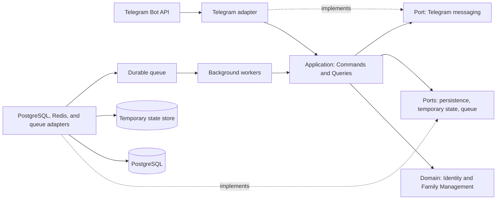

# Family Expenses MVP — System Design

**Status:** Phase 1 design

**Scope:** Phase 1 domain design plus cross-cutting storage and messaging choices required by existing flows. Expense, catalog, reporting, and recurring-expense domain designs remain deferred.

**Requirements:** [Business Requirements](business_requirements.md) §§4–5, 6.2.1, 6.3, 7.1, 12; [NFRs](nfr_requirements.md) §§1–3.

**UI:** [Family Management](specs/family_management.md), [Settings](specs/settings.md), and [Main Menu](specs/main_menu.md).

## 1. Architecture

Build a modular monolith with layered architecture, following [NFR §3](nfr_requirements.md#3-reliability-and-technical-constraints).

Ports are defined by the inner layer that needs them; infrastructure implements them. Keep Telegram types, database models, and queue messages out of domain objects.

## 2. Phase 1 bounded contexts

### Identity and Preferences

Own the user identified by `telegram_user_id` and the user's selected language. Telegram display name and username are optional profile data, never identity keys.

### Family Management

Own families, family settings, memberships, invitations, and invitation uses. Family settings belong to this context; user language does not.

This context enforces the family and invitation rules in Business Requirements §4.

Keep auditing as a cross-cutting application capability, not part of any aggregate. Write audit snapshots in the same transaction as the business mutation. Use the outbox only for domain events that have an asynchronous consumer; keep those integration payloads limited to the consumer's needs. Never include a plaintext invitation token in logs or audit messages.

Do not define expense, catalog, reporting, or recurring-expense contexts in this Phase 1 design. Define them before their implementation phases.

## 3. Domain and persistence model

Use PostgreSQL as the source of truth for transactional business data and the transactional outbox.

Use the logical entities in [NFR §2](nfr_requirements.md#2-suggested-data-model), with these ownership boundaries:

- Identity and Preferences owns `User`.
- Family Management owns `Family`, `FamilyMember`, `Invitation`, and `InvitationUse`.
- Store active-family selection with durable user preferences in PostgreSQL.
- `AuditLog` records the changes required by NFR §§1–2 transactionally; it does not depend on an asynchronous consumer.
- Infrastructure uses `TelegramUpdateInbox`, `OutboxMessage`, and `CommandExecution` records for reliable update and queued-command processing.

Active-family selection is a navigation preference, not authorization. Resolve it against current membership on every family-scoped operation. Store only the update data needed for processing and replay; apply a retention policy to processed inbox records.

### Temporary state

Use Redis or a compatible managed key-value store as temporary storage, not as a cache. Its values are the source of truth for the workflows they hold until those workflows expire or complete. Keep this store separate from PostgreSQL business records, and configure it so application restarts do not erase unexpired state or evict it under memory pressure.

Use it for short-lived Telegram conversation state and Active/Paused expense drafts. Expense draft keys are scoped to `(user_id, family_id)` and their TTL follows Business Requirements §6.2.1. The storage choice satisfies the draft restart requirement in [Add Expense UI §8.2](specs/add_expense.md#82-draft-guarantees).

`Saving` and `SaveUnknown` cannot rely on an expiring draft key. Before attempting to save an expense, persist the idempotency key and immutable save snapshot in PostgreSQL as an `ExpenseSaveAttempt`. Keep an unresolved attempt there without a TTL until reconciliation; complete it atomically with the expense commit when the save succeeds. Define the full expense draft model in the expense phase.

Treat `Family` as the aggregate for its settings. Treat each membership and invitation as separate aggregate roots; do not load all members or invitations into a Family aggregate. The aggregate defines the domain consistency boundary; a database transaction may also write technical outbox records without making them part of the aggregate. Use cross-aggregate transactions only where MVP behavior requires atomicity: family creation with its creator membership, and invitation use with membership creation. For invitation use, atomically check the limit and insert `InvitationUse`; lock or otherwise serialize concurrent use of that invitation.

Use database constraints for unique Telegram IDs, memberships, invitation token hashes, and invitation uses. Store only a hash of the secret invitation token. Generate a cryptographically random token that fits the Telegram `start` parameter limit in NFR §3.

## 4. Application boundaries

Organize application use cases by bounded context. Each state-changing use case has a Command handler; reads have Query handlers. Keep validation and authorization in application/domain services, not Telegram handlers.

Phase 1 commands include creating a family, changing family settings, creating/revoking invitations, and joining a family. Queries include listing the user's families, viewing members/invitations, and reading settings. The UI routes and fields remain defined in the linked UI specifications.

For every request, resolve the Telegram user, active family, and relevant entity, then revalidate membership and authorization. A queued command must repeat authorization checks when the worker executes it; captured family context alone is not authority.

## 5. Telegram updates and interaction state

Support Telegram webhooks and long polling as interchangeable delivery adapters into the same update processor. Use a webhook for production and long polling for local development. Run only one delivery mode at a time for a bot: clear its webhook before starting polling, and stop polling before registering a webhook. Verify the webhook secret token. Persist each incoming `update_id` before processing it; advance the polling offset only after processing succeeds, and do not repeat already processed updates.

The Telegram adapter maps messages and callback queries to application requests. It handles Telegram-specific formatting, keyboards, callback answers, and message delivery. Callback data carries relevant IDs when they fit; otherwise it carries a short opaque reference to server-side interaction state plus an action/revision. Resolve references and recheck authorization on the server; never treat callback data as authorization.

Keep temporary Settings/Family Management form state in `UserInteractionState`, keyed to the user and private chat. Store the relevant family ID and revision when a flow is family-scoped. Reject stale actions and revalidate membership before applying them. The state is resumable across process restarts but is not a substitute for the business records it references.

Process updates for one private chat in order so a delayed text reply cannot be applied to a later prompt. Do not block webhook acknowledgment on a slow external service or background command.

## 6. Queued commands and results

Use RabbitMQ for work that is asynchronous or background-driven; do not enqueue every short command by default. Keep it behind a queue port so transport details do not enter application or domain code. Queue messages use versioned, language-independent JSON contracts, not serialized framework or domain objects.

Use the transactional outbox for domain events with asynchronous consumers: commit each business mutation and its outgoing event together, then publish it to the queue. Do not write an outbox record solely to create an audit entry; audit snapshots are written transactionally as described in §3. Consumers must tolerate duplicate delivery and use a stable message ID for idempotency. Store the final command outcome in `CommandExecution` before attempting to notify the user. Keep only the minimum request and result data needed to process the command and show its outcome.

For a queued command, acknowledge a callback promptly and tell the user that processing started. After commit, send the result in the private chat or update the bot's progress message. If Telegram cannot deliver the result, retain it and show it on the user's next interaction. Never report success before commit.

The database remains authoritative if RabbitMQ is unavailable. Retry publishing undelivered outbox records after recovery. Broker topology, retry intervals, concurrency, and which use cases run asynchronously are implementation choices constrained by this flow.

## 7. Transactions and audit

For each mutation below, write the required audit record in the same transaction:

- Create a family, its creator membership, and the user's active-family selection atomically.
- Update a family setting.
- Create or revoke an invitation.
- Join under a transaction that validates invitation state and use limit and creates membership and `InvitationUse`.

If the user is already a member, do not consume an invitation use. Enforce the join checks in the transaction; if a concurrent join wins the unique membership constraint, treat the retry as already joined without recording another use.

## 8. Deferred decisions

- Database and RabbitMQ deployment/operations details.
- Keep store and category search behind a search port. Evaluate PostgreSQL with `pg_trgm` against Business Requirements §6.3; choose the engine and deployment after that evaluation.
- Columnar/reporting read models and selective event sourcing; consider them in the relevant later system design only if justified.
- System design for expenses, stores/categories, reporting, and recurring expenses.
