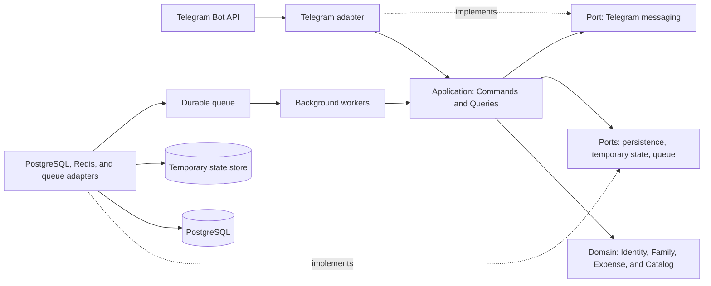

# Family Expenses MVP — System Design

**Status:** Phase 1 and Phase 2 design

**Scope:** Phase 1 and Phase 2 design. Phase 2 covers the boundaries specified in [Business Requirements §14](business_requirements.md#14-implementation-phases): stores, aliases, categories, expense create/edit/delete, category allocations, expense cards, and history. Currency conversion and reports are Phase 3; recurring expenses are Phase 4. All remain in MVP scope.

**Requirements:** [Business Requirements](business_requirements.md) §§3–6.7, 10, 12, 14; [NFRs](nfr_requirements.md) §§1–3.

**UI:** [Add Expense](specs/add_expense.md), [Expense History](specs/expense_history.md), [Stores](specs/stores.md), [Categories](specs/categories.md), [Family Management](specs/family_management.md), [Settings](specs/settings.md), and [Main Menu](specs/main_menu.md). Currency/conversion controls, report features, and recurring flows are implemented in their later phases.

## 1. Architecture

Build a modular monolith with layered architecture, following [NFR §3](nfr_requirements.md#3-reliability-and-technical-constraints).

Ports are defined by the inner layer that needs them; infrastructure implements them. Keep Telegram types, database models, and queue messages out of domain objects.

## 2. Bounded contexts

### Identity and Preferences

Own the user identified by `telegram_user_id` and the user's selected language. Telegram display name and username are optional profile data, never identity keys.

### Family Management

Own families, family settings, memberships, invitations, and invitation uses. Family settings belong to this context; user language does not.

This context enforces the family and invitation rules in Business Requirements §4.

Keep auditing as a cross-cutting application capability, not part of any aggregate. Write audit snapshots in the same transaction as the business mutation. Use the outbox only for domain events that have an asynchronous consumer; keep those integration payloads limited to the consumer's needs. Never include a plaintext invitation token in logs or audit messages.

### Phase 2: Expenses and Catalog

Expense Management owns expenses and category allocations. An `Expense` is the aggregate root; its allocations are children because their amounts must reconcile exactly to the expense total.

The family-scoped Catalog owns stores, store aliases, and categories. They are separate aggregates from expenses. Expense records refer to them by IDs, not ORM associations. Catalog search is a query capability; it must not become an alternate source of truth for names or family ownership.

Paginated history, expense details, and the Phase 2 search/filter behavior are Expense Management queries. Exchange-rate providers, saved conversions, amount search across currencies, reports, and recurring-expense scheduling are designed in later phases.

## 3. Domain and persistence model

Use PostgreSQL as the source of truth for transactional business data and the transactional outbox.

Use the logical entities in [NFR §2](nfr_requirements.md#2-suggested-data-model), with these ownership boundaries:

- Identity and Preferences owns `User`.
- Family Management owns `Family`, `FamilyMember`, `Invitation`, and `InvitationUse`.
- Expense Management owns `Expense` and `ExpenseCategory`.
- The family-scoped Catalog owns `Store`, `StoreAlias`, and `Category`.
- Store active-family selection with durable user preferences in PostgreSQL.
- `AuditLog` records the changes required by NFR §§1–2 transactionally; it does not depend on an asynchronous consumer.
- Infrastructure uses `TelegramUpdateInbox`, `OutboxMessage`, and `CommandExecution` records for reliable update and queued-command processing. Expense Management uses a durable `ExpenseSaveAttempt` for save idempotency and recovery.

Use a distinct immutable identifier value object for each entity ID in domain APIs. Convert UUID strings at the transport/application boundary and map identifier objects to PostgreSQL UUID columns through explicit Doctrine types. Keep persistence conversion out of entities.

Active-family selection is a navigation preference, not authorization. Resolve it against current membership on every family-scoped operation. Store only the update data needed for processing and replay; apply a retention policy to processed inbox records.

### Expense persistence and consistency

- Keep the original amount, currency, purchase date, creator, family, and store on `Expense`. Persist category allocations separately, with the expense ID, category ID, and allocation amount. Store money as exact decimals, enforce currency precision, and never use binary floating point.
- Keep the database authoritative. Enforce family ownership of expense, store, category, and default-category references using composite foreign keys where practical; also validate the active member and referenced records in the application transaction. Index family-scoped history by purchase date and exclude soft-deleted expenses from normal queries.
- Save an expense, all allocations, its audit snapshot, and the completion result for its save attempt atomically. Validate allocation reconciliation in the domain/application layer; reject incomplete or non-positive rows before persistence.
- Persist an `ExpenseSaveAttempt` and immutable snapshot before the first save transaction, with a unique idempotency key. Use the key to return the same committed expense after retries or an ambiguous result. Do not expire unresolved attempts; an unresolved attempt is reconciled before the draft can be replaced.
- Keep original expense amount and currency authoritative. Conversion entities, provider-rate caching, and reporting-currency behavior are Phase 3 design; do not make Phase 2 expense writes depend on an exchange-rate service.

### Draft and save lifecycle

Keep Active/Paused expense drafts in the durable temporary-state store keyed by `(user_id, family_id)`, with the 24-hour inactivity expiry defined in Business Requirements §6.2.1. Enforce at most one nonterminal draft per tuple and serialize changes with a lock or revision check. A family switch changes which draft is accessible; it does not move or rewrite a draft.

Before saving, move the draft to `Saving` and persist its idempotency key and immutable snapshot in PostgreSQL. On commit, mark the save attempt complete and the draft saved. On an ambiguous outcome, retain `SaveUnknown` and reconcile by the same key; neither the attempt nor its snapshot may expire. See [Add Expense UI §8](specs/add_expense.md#8-draft-storage-and-lifecycle) for the user-visible lifecycle. Add conversion state to the draft only in Phase 3.

### Catalog and search

Keep family-scoped uniqueness in PostgreSQL using the canonical `dedupe_key` and unique constraints described in Business Requirements §6.3. Search matching may be broader than hard-key uniqueness, but fuzzy/transliterated results are suggestions only. Re-fetch selected candidates from the database, scoped to the current family. Keep the search engine behind a port; evaluate PostgreSQL `pg_trgm` against the required transliteration and edit-distance behavior before choosing an index or external service. Database constraints remain authoritative when search is unavailable.

Serialize family-scoped Catalog mutations by locking the owning family row inside the command transaction. PostgreSQL releases this lock when that transaction commits or rolls back; do not rely on the lock after the command handler returns. The current model persists `StoreAlias` as a separate entity. Prefer treating it as a child entity of `Store` in the domain model, while preserving family-wide alias/name uniqueness as a transaction/database invariant across stores; reconcile this ownership change with persistence and event handling before implementing it.

Use specific domain-event types for auditable entity changes rather than relying on a generic event plus an action string to identify the event. Audit snapshots remain written transactionally and are independent of asynchronous outbox delivery.

### Temporary state

Use Redis or a compatible managed key-value store as temporary storage, not as a cache. Its values are the source of truth for the workflows they hold until those workflows expire or complete. Keep this store separate from PostgreSQL business records, and configure it so application restarts do not erase unexpired state or evict it under memory pressure.

Use it for short-lived Telegram conversation state and Active/Paused expense drafts. Expense draft keys are scoped to `(user_id, family_id)` and their TTL follows Business Requirements §6.2.1. The storage choice satisfies the draft restart requirement in [Add Expense UI §8.2](specs/add_expense.md#82-draft-guarantees). `Saving` and `SaveUnknown` recovery is durable in PostgreSQL as described above.

Treat `Family` as the aggregate for its settings. Treat each membership and invitation as separate aggregate roots; do not load all members or invitations into a Family aggregate. The aggregate defines the domain consistency boundary; a database transaction may also write technical outbox records without making them part of the aggregate. Use cross-aggregate transactions only where MVP behavior requires atomicity: family creation with its creator membership, and invitation use with membership creation. For invitation use, atomically check the limit and insert `InvitationUse`; lock or otherwise serialize concurrent use of that invitation.

Use database constraints for unique Telegram IDs, memberships, invitation token hashes, and invitation uses. Store only a hash of the secret invitation token. Generate a cryptographically random token that fits the Telegram `start` parameter limit in NFR §3.

## 4. Application boundaries

Organize application use cases by bounded context. Each state-changing use case has a Command handler; reads have Query handlers. Keep validation and authorization in application/domain services, not Telegram handlers.

Phase 1 commands include creating a family, changing family settings, creating/revoking invitations, and joining a family. Queries include listing the user's families, viewing members/invitations, and reading settings.

Phase 2 commands include creating, editing, and soft-deleting expenses; creating and managing family stores/categories; and updating store aliases or default categories. Queries include family-scoped catalog selection/search and paginated history/detail reads. Keep field validation and authorization in application/domain services, not Telegram handlers. The UI routes and fields remain defined in the linked UI specifications.

For every request, resolve the Telegram user, active family, and relevant entity, then revalidate membership and authorization. A queued command must repeat authorization checks when the worker executes it; captured family context alone is not authority.

Expense writes are synchronous database transactions; do not send ordinary expense saves through RabbitMQ. Phase 2 expense creation and editing do not depend on external rate providers. Add bounded provider calls and conversion review in Phase 3, outside the write transaction, and revalidate the reporting-currency snapshot before committing any saved conversion. Use the outbox only if a real asynchronous consumer is introduced.

## 5. Telegram updates and interaction state

Support Telegram webhooks and long polling as interchangeable delivery adapters into the same update processor. Use a webhook for production and long polling for local development. Run only one delivery mode at a time for a bot: clear its webhook before starting polling, and stop polling before registering a webhook. Verify the webhook secret token. Persist each incoming `update_id` before processing it; advance the polling offset only after processing succeeds, and do not repeat already processed updates.

The Telegram adapter maps messages and callback queries to application requests. It handles Telegram-specific formatting, keyboards, callback answers, and message delivery. Callback data carries relevant IDs when they fit; otherwise it carries a short opaque reference to server-side interaction state plus an action/revision. Resolve references and recheck authorization on the server; never treat callback data as authorization.

Keep temporary Telegram interaction state in `UserInteractionState`, keyed to the user and private chat. Store the relevant family ID and revision when a flow is family-scoped. Reject stale actions and revalidate membership before applying them. The state is resumable across process restarts but is not a substitute for the business records it references. Expense draft ownership, storage, and save recovery follow §3.

Process updates for one private chat in order so a delayed text reply cannot be applied to a later prompt. Do not block webhook acknowledgment on a slow external service or background command.

## 6. Queued commands and results

Use RabbitMQ for work that is asynchronous or background-driven; do not enqueue every short command by default. Keep it behind a queue port so transport details do not enter application or domain code. Queue messages use versioned, language-independent JSON contracts, not serialized framework or domain objects.

Use the transactional outbox for domain events with asynchronous consumers: commit each business mutation and its outgoing event together, then publish it to the queue. Do not write an outbox record solely to create an audit entry; audit snapshots are written transactionally as described in §3. Use a versioned JSON envelope and stable message ID so consumers can tolerate duplicate delivery. Keep delivery failures pending and retry up to ten total publishing attempts, with exponential delays totaling about one hour; then mark the outbox record failed. After restoring broker availability, `app:outbox:retry-failed` makes one publishing attempt per selected failed record; failed attempts remain failed until the command is run again. Consumer processing retries and dead-letter handling are separate from outbox delivery and should use the queue's failure transport. Store the final command outcome in `CommandExecution` before attempting to notify the user. Keep only the minimum request and result data needed to process the command and show its outcome.

For a queued command, acknowledge a callback promptly and tell the user that processing started. After commit, send the result in the private chat or update the bot's progress message. If Telegram cannot deliver the result, retain it and show it on the user's next interaction. Never report success before commit.

The database remains authoritative if RabbitMQ is unavailable. Pending outbox records retry automatically; after ten unsuccessful publishing attempts, failed records can be retried manually after broker recovery. Broker topology, concurrency, and which use cases run asynchronously are implementation choices constrained by this flow.

## 7. Transactions and audit

For each mutation below, write the required audit record in the same transaction:

- Create a family, its creator membership, and the user's active-family selection atomically.
- Update a family setting.
- Create or revoke an invitation.
- Join under a transaction that validates invitation state and use limit and creates membership and `InvitationUse`.
- Create, edit, or soft-delete an expense together with its allocations.
- Create or change a store/category and their aliases or default-category references.

If the user is already a member, do not consume an invitation use. Enforce the join checks in the transaction; if a concurrent join wins the unique membership constraint, treat the retry as already joined without recording another use.

## 8. Later system-design phases

- **Phase 3 — Reporting and currencies:** provider adapters and rate cache, saved/manual expense conversions, reporting-currency changes, report aggregation, currency-aware search refinements, and CSV/XLSX export.
- **Phase 4 — Recurring expenses and hardening:** schedule processing, occurrence lifecycle, grouped notification delivery, and complete audit/idempotency/security coverage.
- Database and RabbitMQ deployment/operations details.
- Any columnar/reporting read model or selective event sourcing, only if later scale or requirements justify it.
